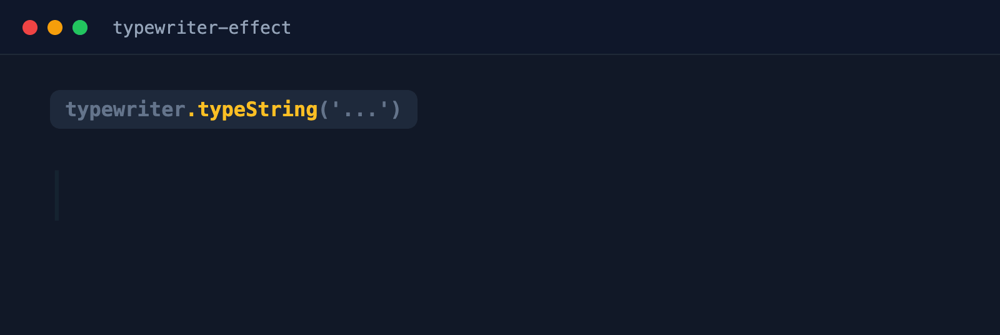

# TypewriterJS v3

[](https://github.com/tameemsafi/typewriterjs/actions/workflows/tests.yaml)



[NPM Repository](https://npmjs.org/typewriter-effect)
[JSFiddle Example](https://jsfiddle.net/hzfxp2L9/)
[Emoji Example](https://codesandbox.io/s/typewriter-effect-emojis-pgz6e)

## CDN

You can use the CDN version of this plugin for fast and easy setup.

```html
<script src="https://unpkg.com/typewriter-effect@3/dist/core.js"></script>
```

If unpkg is down, you can use jsDelivr instead.

```html
<script src="https://cdn.jsdelivr.net/npm/typewriter-effect@3/dist/core.js"></script>
```

## Upgrading to v3

Version 3 drops support for Internet Explorer 11 and other outdated browsers, and changes how the React component handles `options` changes. See [CHANGELOG.md](CHANGELOG.md) for all breaking changes.

## Installation
You can install Typewriterjs with just one command and you're good to go
```shell

# with npm
npm i typewriter-effect

# with yarn
yarn add typewriter-effect

```

## Browser support

Supported browsers follow [Baseline Widely available](https://web.dev/baseline), which covers browser versions released in the last 30 months, including Chromium based browsers such as Samsung Internet and Opera. This is set using the browserslist query `baseline widely available with downstream` in `package.json`.

## Building

You will need to bundle the javascript before it can be used, this can be done using `npm run build:dev` for development or `npm run build:prod` for production.

Building and running the tests requires Node.js 26 or newer. If you use [nvm](https://github.com/nvm-sh/nvm), run `nvm use` to switch to the version in `.nvmrc`.

This only applies to working on this project. Websites and apps that install `typewriter-effect` can use any Node.js version.

## Core

This is the base version of the typewriter effect. It will need a the bundled version of the javascript to work correctly.

See examples in the 'examples' folder.

```js
import Typewriter from 'typewriter-effect/dist/core';

new Typewriter('#typewriter', {
  strings: ['Hello', 'World'],
  autoStart: true,
});
```

## Options

| Name | Type | Default value | Description |
| --- | --- | --- | --- |
| strings | String or Array | null | Strings to type out when using ``autoStart`` option |
| cursor | String | Pipe character | String value to use as the cursor. |
| delay | 'natural', Number or ``{ min, max }`` | 'natural' | The delay between each key when typing. Use ``{ min: 50, max: 100 }`` to pick a random delay between two values. |
| deleteSpeed | 'natural', Number or ``{ min, max }`` | 'natural' | The delay between deleting each character. Use ``{ min: 20, max: 40 }`` to pick a random delay between two values. |
| loop | Boolean | false | Whether to keep looping or not. |
| autoStart | Boolean | false | Whether to autostart typing strings or not. You are required to provide ``strings`` option. |
| pauseFor | Number | 1500 | The pause duration after a string is typed when using autostart mode |
| devMode | Boolean | false | Whether or not to display console logs. |
| skipAddStyles | Boolean | false | Skip adding default typewriter css styles. |
| wrapperClassName | String | 'Typewriter__wrapper' | Class name for the wrapper element. |
| cursorClassName | String | 'Typewriter__cursor' | Class name for the cursor element. The blinking animation uses the ``Typewriter__cursor`` class, so include it to keep the blinking, for example ``'Typewriter__cursor my-cursor'``. |
| stringSplitter | Function | null | String splitter function, can be used to [split emoji's](https://codesandbox.io/s/typewriter-effect-emojis-pgz6e) |
| onCreateTextNode | Function | null | Callback function to replace the internal method which creates a text node for the character before adding it to the DOM. If you return null, then it will not add anything to the DOM and so it is up to you to handle it. |
| onRemoveNode | Function | null | Callback function when a node is about to be removed. First param will be an object `{ node: HTMLNode, character: string }`. The `character` is only set when a text node is removed. |
| maxCatchUpDelta | Number | null | Max milliseconds of elapsed time to catch up on in a single frame. When set, several events can run per frame so typing keeps its pace after the tab was inactive. Disabled by default (one event per frame). |
| parseHTML | Boolean | true | Whether strings that look like HTML should be added as HTML elements. Set to `false` to always type strings exactly as written, for example when the text contains `<` or `>` characters or comes from users. |
| initialText | String | null | Text that is shown straight away when the typewriter is created. It can be deleted like typed text, and it is not typed again when looping. |
| keepLastString | Boolean | false | Keep the last string of the ``strings`` option on the page instead of deleting it. Only used when ``loop`` is false. |
| deleteOnLoop | Boolean | true | Whether to delete everything when the loop starts again. Set to ``false`` to keep adding text on every loop. |
| cursorBlink | Boolean | true | Whether the cursor blinks. |
| useGraphemeSplitter | Boolean | false | Split strings into graphemes, so emojis like 👨‍👩‍👧 and letters with accents or marks are typed and deleted as one character. Ignored when ``stringSplitter`` is set. |
| mergeTextNodes | Boolean | false | Add typed characters to a single text node instead of one text node for each character. Fixes text shaping in Safari for scripts such as Arabic or Thai, and makes long text faster. Ignored when ``onCreateTextNode`` is set. |
| pasteAsCharacters | Boolean | false | Let ``deleteChars`` delete pasted text one character at a time, instead of deleting the whole pasted string at once. Ignored when ``onCreateTextNode`` is set. |
| reserveSpace | Boolean | false | Reserve the space that the typed text will need, so the page does not move while typing. The space is worked out from the queued events each time ``start`` is called, and is as big as the largest text that will be shown. |
| onlyDelayVisibleChanges | Boolean | false | Only wait for ``delay`` or ``deleteSpeed`` when a character is typed, pasted or deleted. Other events such as ``callFunction``, ``pauseFor``, ``changeDelay`` and empty HTML tags run straight away, and ``pasteString`` with HTML is pasted in one step. |

## Methods

All methods can be chained together.

| Name | Params | Description |
| --- | --- | --- |
| start | - | Start the typewriter effect. |
| stop | - | Stop the typewriter effect. |
| pause | - | Pause the typewriter effect. Call ``start`` to continue. |
| skipToEnd | - | Run every event in the queue straight away, without any delay or pause. Useful for a skip button. When looping, call ``stop`` after it to keep the final text on the page. |
| clearQueue | - | Remove every event that has not run yet. Call ``start`` again after adding new events. |
| moveCursor | ``amount`` Number of characters, negative to move left | Move the cursor by an amount of characters. Typed, pasted and deleted text then happens at the cursor. |
| moveCursorToStart | - | Move the cursor before all of the text. |
| moveCursorToEnd | - | Move the cursor after all of the text. |
| pauseFor | ``ms`` Time to pause for in milliseconds | Pause for milliseconds |
| typeString | ``string`` String to type out, it can contain HTML tags | Type out a string using the typewriter effect. |
| pasteString | ``string`` String to paste out, it can contain HTML tags | Paste out a string. |
| deleteAll | ``speed`` Speed to delete all visibles nodes, can be number or 'natural'. Defaults to 'natural' | Delete everything that is visible inside of the typewriter wrapper element. |
| deleteAllWithDeleteSpeed | - | Delete everything that is visible inside of the typewriter wrapper element using the current ``deleteSpeed`` option. |
| clear | - | Remove everything that is visible inside of the typewriter wrapper element straight away, without a delete animation. |
| deleteChars | ``amount`` Number of characters | Delete and amount of characters, starting at the end of the visible string. |
| callFunction | ``cb`` Callback, ``thisArg`` this Object to bind to the callback function | Call a callback function. The first parameter to the callback ``elements`` which contains all DOM nodes used in the typewriter effect. |
| changeDeleteSpeed | ``speed`` Number or 'natural' | The speed at which to delete the characters, lower number is faster. |
| changeDelay | ``delay`` Number or 'natural' | Change the delay when typing out each character |
| changeCursor | ``cursor`` String to use as the cursor | Change the cursor. Use an empty string to hide the cursor. |

## HTML strings

``typeString`` and ``pasteString`` add strings that contain HTML tags as real HTML elements.

- Void elements such as ``<br>`` and ```` count as one character when using ``deleteChars``.
- HTML comments are ignored.
- To show a ``<`` or ``>`` character inside a string that contains HTML, use ``&lt;`` and ``&gt;``. For example ``'<strong>Note:</strong> 1 &lt; 2'``.
- To type a string exactly as written without any HTML, set the ``parseHTML`` option to ``false``.

## Security

Strings that contain HTML and the ``cursor`` option are added to the page using ``innerHTML``. Passing text from users or other untrusted sources can run scripts on your page (XSS).

- Never pass untrusted text to the ``cursor`` option.
- Never pass untrusted text to ``typeString``, ``pasteString`` or ``strings`` while ``parseHTML`` is enabled. Set ``parseHTML: false`` when the text is not fully under your control.

## Examples

### Basic example

```js
var app = document.getElementById('app');

var typewriter = new Typewriter(app, {
  loop: true,
  delay: 75,
});

typewriter
  .pauseFor(2500)
  .typeString('A simple yet powerful native javascript')
  .pauseFor(300)
  .deleteChars(10)
  .typeString('<strong>JS</strong> plugin for a cool typewriter effect and ')
  .typeString('<strong>only <span style="color: #27ae60;">5kb</span> Gzipped!</strong>')
  .pauseFor(1000)
  .start();
```

### Custom text node creator using callback

```js
var app = document.getElementById('app');

var customNodeCreator = function(character) {
  return document.createTextNode(character);
}

var typewriter = new Typewriter(app, {
  loop: true,
  delay: 75,
  onCreateTextNode: customNodeCreator,
});

typewriter
  .typeString('A simple yet powerful native javascript')
  .pauseFor(300)
  .start();
```

### Custom handling text insert using input placeholder

```js
var input = document.getElementById('input')

var customNodeCreator = function(character) {
  // Add character to input placeholder
  input.placeholder = input.placeholder + character;

  // Return null to skip internal adding of dom node
  return null;
}

var onRemoveNode = function({ character }) {
  if(input.placeholder) {
    // Remove last character from input placeholder
    input.placeholder = input.placeholder.slice(0, -1)
  }
}

var typewriter = new Typewriter(null, {
  loop: true,
  delay: 75,
  onCreateTextNode: customNodeCreator,
  onRemoveNode: onRemoveNode,
});

typewriter
  .typeString('A simple yet powerful native javascript')
  .pauseFor(300)
  .start();
```

## React

This includes a React component which can be used within your project. You can pass in a onInit function which will be called with the instance of the typewriter so you can use the typewriter core API.

```jsx
import Typewriter from 'typewriter-effect';

<Typewriter
  onInit={(typewriter) => {
    typewriter.typeString('Hello World!')
      .callFunction(() => {
        console.log('String typed out!');
      })
      .pauseFor(2500)
      .deleteAll()
      .callFunction(() => {
        console.log('All strings were deleted');
      })
      .start();
  }}
/>
```

Alternatively you can also pass in options to use auto play and looping for example:

```jsx
import Typewriter from 'typewriter-effect';

<Typewriter
  options={{
    strings: ['Hello', 'World'],
    autoStart: true,
    loop: true,
  }}
/>
```

When the ``options`` prop changes, the current typewriter is stopped and a new one is created. The ``onInit`` function is then called again with the new instance. Functions inside ``options``, such as ``stringSplitter``, are not compared, so creating a new inline function on every render will not restart the effect.

### Props

| Name | Type | Default value | Description |
| --- | --- | --- | --- |
| onInit | Function | - | Called with the typewriter instance so you can use the core methods. |
| options | Object | - | Any of the options listed above. |
| component | String or Component | 'div' | Element used to wrap the typewriter, for example ``'span'``. |
| className | String | - | Extra class names added after the ``Typewriter`` class. |

Any other props, such as ``id``, ``style``, ``aria-label``, ``translate`` or ``data-*`` attributes, are passed to the element.

```jsx
<Typewriter
  component='span'
  className='hero-title'
  translate='no'
  data-scroll='true'
  options={{ strings: ['Hello', 'World'], autoStart: true }}
/>
```

The core class is also exported as ``TypewriterClass``.

```js
import { TypewriterClass } from 'typewriter-effect';

const typewriter = new TypewriterClass('#app', { delay: 75 });
```

## Command line

The package includes a command line tool that plays a typewriter effect in your terminal, or saves it as a GIF for a README, docs or social media.

```shell
# Type strings in the terminal
npx typewriter-effect "Hello" "World"

# Watch a tour of the features
npx typewriter-effect --demo

# Save a GIF
npx typewriter-effect "Hello <strong>World</strong>" --gif hello.gif
```

### Creating GIFs

GIFs are recorded in a headless browser with the real typewriter, so HTML, colors and every option work the same way as on a website. Creating a GIF needs [puppeteer](https://pptr.dev) and [ffmpeg](https://ffmpeg.org).

```shell
npm install --save-dev puppeteer
brew install ffmpeg # or sudo apt install ffmpeg

npx typewriter-effect --config typewriter.json --gif demo.gif
```

If you already have Chrome installed, you can use ``puppeteer-core`` instead and pass ``--chrome <path>`` when Chrome is not found.

The GIF in this readme is made with ``npm run demo:gif``.

### Config file

Use a JSON or JavaScript file to describe each step. Each step has one key, which is the name of a method, and its value is the argument. Use ``true`` for methods without an argument.

```json
{
  "options": {
    "delay": { "min": 50, "max": 90 },
    "deleteSpeed": 30
  },
  "gif": {
    "title": "my-app",
    "theme": "dark",
    "width": 800,
    "fontSize": 40
  },
  "steps": [
    { "label": "Welcome" },
    { "typeString": "Hello <span class=\"green\">World</span>" },
    { "pauseFor": 1000 },
    { "deleteChars": 5 },
    { "typeString": "<strong>everyone</strong> 👋" },
    { "moveCursorToEnd": true },
    { "pauseFor": 1500 }
  ]
}
```

- ``steps`` can use ``typeString``, ``pasteString``, ``deleteChars``, ``deleteAll``, ``deleteAllWithDeleteSpeed``, ``clear``, ``pauseFor``, ``changeDelay``, ``changeDeleteSpeed``, ``changeCursor``, ``moveCursor``, ``moveCursorToStart`` and ``moveCursorToEnd``.
- A ``label`` step shows a small label above the text, which is useful to explain each part of a demo.
- Instead of ``steps``, you can pass ``strings``, which works like the ``strings`` option.
- ``options`` can use any of the typewriter options. The command line turns on ``useGraphemeSplitter``, ``mergeTextNodes`` and ``onlyDelayVisibleChanges`` by default.
- Colors can be added with the classes ``green``, ``blue``, ``pink``, ``amber``, ``red``, ``purple`` and ``dim``, or with ``style="color: #34d399"``. In the terminal, ``b``, ``strong``, ``i``, ``em``, ``u``, ``code`` and ``br`` tags are supported too.

### Command line options

| Option | Description |
| --- | --- |
| ``-c, --config <file>`` | JSON or JavaScript file with options and steps. |
| ``--demo`` | Play the built-in tour of the features. |
| ``-g, --gif <file>`` | Save a GIF instead of playing in the terminal. |
| ``--delay <speed>`` | Delay between typed characters: ``natural``, a number or a range like ``50-90``. |
| ``--delete-speed <speed>`` | Delay between deleted characters: ``natural``, a number or a range like ``20-40``. |
| ``--pause <ms>`` | Pause after each string. Defaults to ``1500``. |
| ``--cursor <text>`` | Cursor text. Defaults to ``\|``. |
| ``--loop`` | Keep looping. In a GIF, the text is deleted at the end so the GIF loops smoothly. |
| ``--width <px>`` | Width of the GIF. Defaults to ``800``. |
| ``--height <px>`` | Height of the GIF. Defaults to the height of the largest text. |
| ``--font-size <px>`` | Font size of the text. Defaults to ``40``. |
| ``--fps <number>`` | Frames per second. Defaults to ``25``. |
| ``--scale <number>`` | Pixel scale. ``2`` looks sharp on high resolution screens. Defaults to ``2``. |
| ``--theme <name>`` | ``dark`` or ``light``. Defaults to ``dark``. |
| ``--title <text>`` | Title in the window bar. |
| ``--plain`` | Hide the window bar. |
| ``--chrome <path>`` | Path to Chrome, when ``puppeteer-core`` is used. |
| ``--ffmpeg <path>`` | Path to ffmpeg. |

When the output is not a terminal, for example when it is piped to a file, the final text is printed without the effect.

## FAQ

### How do I keep the text after typing the ``strings`` option?

Set ``keepLastString: true``. Without ``loop``, the last string will stay on the page. You can also pass a single string instead of an array, which is never deleted.

```js
new Typewriter('#app', {
  strings: ['Hello', 'World'],
  autoStart: true,
  keepLastString: true,
});
```

### How do I start with some text already on the page?

Use the ``initialText`` option. The text is shown straight away and can be deleted like typed text.

```js
new Typewriter('#app', { initialText: 'Hello World' })
  .pauseFor(1000)
  .deleteChars(5)
  .typeString('everyone')
  .start();
```

### How do I hide the cursor when typing is done?

Call ``changeCursor('')`` at the end of the chain. To keep the cursor but stop the blinking, set ``cursorBlink: false``.

```js
typewriter
  .typeString('Hello World!')
  .changeCursor('')
  .start();
```

### How do I clear the text straight away, or skip the typing?

- ``clear()`` removes everything straight away without a delete animation.
- ``clearQueue()`` removes every event that has not run yet, so you can add new ones.
- ``skipToEnd()`` runs every event in the queue straight away, which is useful for a skip button.

```js
skipButton.addEventListener('click', () => {
  typewriter.skipToEnd();
});

resetButton.addEventListener('click', () => {
  typewriter.clearQueue().clear().typeString('Something new').start();
});
```

### How do I delete text at the ``deleteSpeed`` option?

``deleteAll()`` uses ``'natural'`` speed by default. Use ``deleteAllWithDeleteSpeed()``, or pass the speed, for example ``deleteAll(10)``.

### Why do emojis or accented letters show up broken while typing?

Strings are split into JavaScript characters by default, which breaks emojis such as 😋 into two parts. Set ``useGraphemeSplitter: true`` to type each emoji or letter as one character.

### Arabic, Thai or other scripts do not join correctly on iPhone or Safari

Safari does not join letters that are in separate text nodes. Set ``mergeTextNodes: true`` so all typed characters are added to one text node. This also makes long text faster, and it lets soft hyphens (``&shy;``) show a hyphen.

```js
new Typewriter('#app', {
  useGraphemeSplitter: true,
  mergeTextNodes: true,
});
```

### How do I type word by word?

Use the ``stringSplitter`` option to split strings into words. ``deleteChars`` will then delete one word at a time.

```js
new Typewriter('#app', {
  stringSplitter: (text) => text.match(/\S+\s*/g) || [],
});
```

### How do I fix a typo or type in the middle of the text?

Move the cursor with ``moveCursor``, then type or delete as normal. A negative amount moves the cursor to the left. ``deleteChars`` deletes the characters before the cursor, and ``deleteAll`` and ``clear`` move the cursor back to the end first.

```js
typewriter
  .typeString('Helo world')
  .moveCursor(-7)
  .typeString('l')
  .moveCursorToEnd()
  .typeString('!')
  .start();
```

### How do I stop the page from moving while the text is typed?

Set ``reserveSpace: true``. The typewriter works out how big the text will get and keeps that space from the start, so content below it does not jump. The space is worked out when ``start`` is called, so events added later are not included until ``start`` is called again.

```js
new Typewriter('#app', {
  strings: ['Short title', 'A much longer title that wraps onto two lines'],
  autoStart: true,
  loop: true,
  reserveSpace: true,
});
```

### How do I keep adding lines with the oldest lines scrolling away?

Type each line into its own element with a new typewriter, and remove the oldest line when there are too many.

```js
const lines = ['Line A', 'Line B', 'Line C', 'Line D'];
const container = document.getElementById('lines');
let lineIndex = 0;

const typeNextLine = () => {
  const line = document.createElement('div');
  container.appendChild(line);

  if(container.children.length > 3) {
    container.firstElementChild.remove();
  }

  new Typewriter(line)
    .typeString(lines[lineIndex % lines.length])
    .changeCursor('')
    .pauseFor(500)
    .callFunction(typeNextLine)
    .start();

  lineIndex += 1;
};

typeNextLine();
```

### How do I type a new line?

Add a ``<br>`` tag, for example ``typeString('Hello<br>World')``.

### How do I use colors, a custom font or other styles?

Use HTML inside the string, for example ``typeString('<span style="color: #27ae60;">green</span>')``, or style the wrapper with the ``wrapperClassName`` option. In React you can also pass a ``className`` prop. Text alignment and line height come from the element you pass in, so style it the same way you would style any other text. CSS values do not use quotes, so use ``font-size: 80px`` not ``font-size: '80px'``.

### My custom ``cursorClassName`` does not blink

The blinking animation uses the ``Typewriter__cursor`` class. Keep it in your class name, for example ``cursorClassName: 'Typewriter__cursor my-cursor'``.

### The cursor is stuck at the side of the text or on the next line

The wrapper and the cursor are inline elements. If the container uses ``display: flex`` or ``display: grid``, they are placed side by side as separate items. Put the typewriter inside an element without flex or grid, or set ``display: block`` on the container. When typing block elements such as ``<div>`` or ``<h1>``, the cursor is added after them, so use inline elements such as ``<span>`` with ``<br>`` for new lines.

### How do I run something when typing finishes, or for each character?

Use ``callFunction`` after the events you want to wait for. To run something for each character, for example to scroll to the bottom or play a sound, use the ``onCreateTextNode`` option.

```js
new Typewriter('#app', {
  onCreateTextNode: (character, textNode) => {
    playKeySound();
    return textNode;
  },
})
  .typeString('Hello World!')
  .callFunction(() => console.log('Done!'))
  .start();
```

### How do I type two elements one after the other?

Start the second typewriter inside ``callFunction`` of the first one.

```js
const second = new Typewriter('#second');

new Typewriter('#first')
  .typeString('First line')
  .callFunction(() => second.typeString('Second line').start())
  .start();
```

### How do I start typing when a button is clicked?

Create the typewriter once the container element is on the page, and call ``start`` inside the click handler. The container must exist when the typewriter is created, otherwise you will get the ``Could not find container element`` error.

```js
const typewriter = new Typewriter('#app');

button.addEventListener('click', () => {
  typewriter.typeString('Hello World!').start();
});
```

### How do I change the typed text in React when state changes?

``onInit`` is only called once. Save the instance and add new events when your state changes.

```jsx
const [typewriter, setTypewriter] = useState(null);

useEffect(() => {
  if(typewriter) {
    typewriter.clearQueue().deleteAll(20).typeString(title).start();
  }
}, [title]);

<Typewriter onInit={(instance) => {
  instance.typeString(title).start();
  setTypewriter(instance);
}} />
```

To start again from the beginning instead, pass a ``key`` prop that changes, for example ``<Typewriter key={title} />``.

### Changing a React prop restarts the typing

Changing the ``options`` prop creates a new typewriter. To change the cursor or classes after typing, use ``changeCursor`` or ``callFunction`` instead of changing ``options``.

```jsx
<Typewriter onInit={(typewriter) => {
  typewriter
    .typeString('Hello')
    .callFunction(({ elements }) => {
      elements.wrapper.classList.add('done');
    })
    .changeCursor('')
    .start();
}} />
```

### Can I change the delay while typing?

``changeDelay`` and ``changeDeleteSpeed`` are added to the queue like other events, so they change the speed for everything after them.

```js
typewriter
  .typeString('Slow ')
  .changeDelay(20)
  .typeString('and now fast!')
  .start();
```

### Next.js shows "Super expression must either be null or a function" or a hydration error

The React component is a client component. Since version 3.1.0 the React build includes ``'use client'``, so it can be imported from a server component. If you still see a hydration error, the typewriter ``div`` is probably inside a ``<p>`` tag. Use ``component='span'`` or move it out of the ``<p>`` tag.

### How do I make it accessible?

The cursor is hidden from screen readers. Screen readers may read the text while it is being typed, so you can hide the typewriter with ``aria-hidden="true"`` and add the full text in a visually hidden element. To respect reduced motion settings, you can stop the blinking and skip the typing.

```js
const reduceMotion = window.matchMedia('(prefers-reduced-motion: reduce)').matches;

const typewriter = new Typewriter('#app', { cursorBlink: !reduceMotion })
  .typeString('Hello World!')
  .start();

if(reduceMotion) {
  typewriter.skipToEnd();
}
```

### How do I use it with RequireJS?

The CDN file registers a module named ``Typewriter``.

```js
require.config({
  paths: { Typewriter: 'https://unpkg.com/typewriter-effect@3/dist/core' },
});

require(['Typewriter'], function(Typewriter) {
  new Typewriter('#app').typeString('Hello').start();
});
```

### Translation tools change the text while typing

Add ``translate="no"`` to the container element, or pass ``translate='no'`` to the React component.
